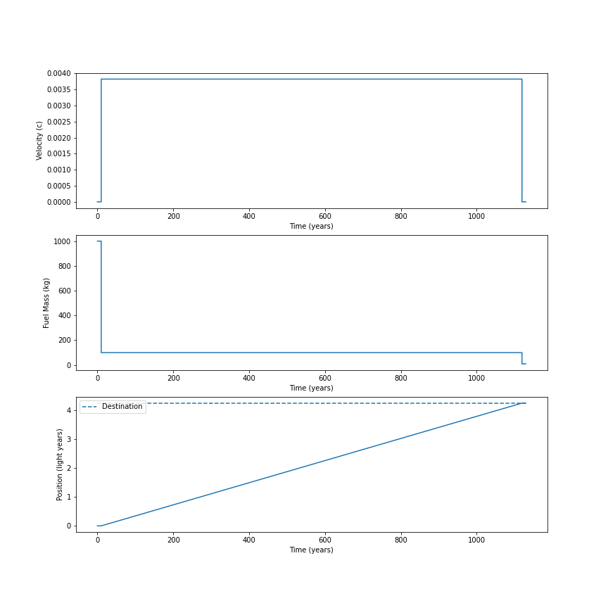

# interstellar_mission_planning
Some tools for planning interstellar missions

# Example mission

The following shows an example mission from the solar system to Proxima Centauri (4.244 light-years). We begin with a 1kg payload and 1000kg of fuel. We assume the exhaust velocity is 500km/s, which is consistent with a fusion rocket. Burning 900kg of fuel accelerates us to a cruising speed of just under 0.4 percent the speed of light (i.e. 0.004c). The trip takes more than 1100 years.



Currently, we assume that fuel escaping the suns gravity is negligible and that the mission is non-relativistic.

## Development Setup

This project uses [`uv`](https://docs.astral.sh/uv/) for Python environment and package management.

### Installation

If `uv` is not already installed on your system, install it via:

```bash
curl -LsSf https://astral.sh/uv/install.sh | sh
```

### Environment Setup

To create the virtual environment and install all dependencies (as locked in `uv.lock`):

```bash
uv sync
```

`uv` will automatically download and use the required Python version (Python 3.9) specified in `.python-version`.

### Running Tests and Linters

Run the test suite:
```bash
uv run pytest
```

Run linters:
```bash
uv run pylint src tests
uv run flake8 --count --statistics
```

### Jupyter Notebooks

To run the interactive notebooks:
```bash
uv run jupyter lab
```